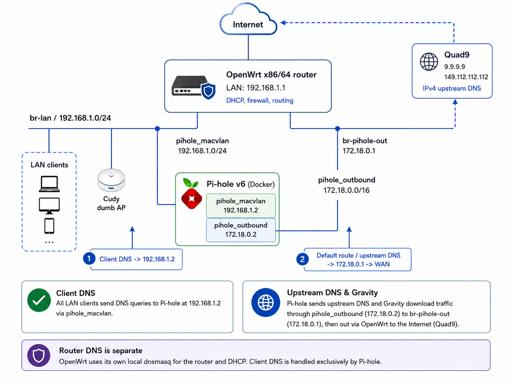

# Running Pi-hole v6 in Docker on OpenWrt x86 with macvlan and a dedicated outbound bridge

A beginner-friendly guide for running Pi-hole v6 in Docker on an OpenWrt x86/64 router while giving Pi-hole its own LAN address through macvlan.

This setup deliberately avoids `network_mode: host`.

Instead, Pi-hole uses two Docker networks:

- `pihole_macvlan` gives Pi-hole its own LAN address.
- `pihole_outbound` provides reliable outbound Internet access through a dedicated Docker bridge.

The result is a Pi-hole container that behaves like a separate device on the LAN, survives router reboots, downloads blocklists normally, and can be advertised automatically to clients through OpenWrt DHCP.

> [!NOTE]
> This guide was built from a real OpenWrt deployment and documents both the working configuration and the problems encountered along the way.

## What this project covers

- OpenWrt x86/64 as the main router
- Docker and Docker Compose on OpenWrt
- Pi-hole v6 using modern `FTLCONF_*` environment variables
- A dedicated macvlan network for Pi-hole
- A separate outbound Docker bridge
- OpenWrt firewall integration
- DHCP option 6 for automatic Pi-hole DNS distribution
- Persistent Pi-hole configuration
- Reboot testing and validation
- DNSSEC and upstream resolver testing
- Optional OpenWrt dumb access point integration
- Troubleshooting common macvlan and DNS problems

## Tested network layout

The reference deployment uses the following addresses:

| Component | Address or network |
|---|---|
| OpenWrt LAN | `192.168.1.1/24` |
| Pi-hole | `192.168.1.2` |
| LAN subnet | `192.168.1.0/24` |
| DHCP pool | `192.168.1.111` to `192.168.1.160` |
| Docker outbound bridge | `172.18.0.0/16` |
| Docker bridge gateway | `172.18.0.1` |
| Pi-hole bridge address | `172.18.0.2` |
| Upstream DNS | Quad9 |
| Timezone | `Europe/Athens` |

These values are examples. Adjust them to match your own LAN and avoid address conflicts.

## Network topology
[](images/network-topology.png)

> Click the diagram to open the full-resolution version.
```text
                             Internet
                                |
                           OpenWrt WAN
                                |
                    OpenWrt x86/64 router
                         192.168.1.1
                                |
                 +--------------+--------------+
                 |                             |
            LAN clients                    Docker
                 |                             |
                 |                   +---------+---------+
                 |                   |                   |
                 |             pihole_macvlan      pihole_outbound
                 |             192.168.1.0/24       172.18.0.0/16
                 |                   |                   |
                 +---------------- Pi-hole ---------------+
                                  192.168.1.2
                                  172.18.0.2
                                       |
                                     Quad9
```

## Why two Docker networks?

A macvlan network gives Pi-hole its own address on the physical LAN, but macvlan also introduces host-isolation behavior.

In this deployment, Pi-hole could communicate with LAN clients but could not reliably reach the OpenWrt host or the Internet using macvlan alone.

The dedicated `pihole_outbound` bridge solves that problem:

```text
LAN DNS traffic  -> pihole_macvlan -> 192.168.1.2
Internet traffic -> pihole_outbound -> 172.18.0.1 -> OpenWrt WAN
```

This keeps the LAN-facing and outbound paths separate and predictable.

## DNS responsibilities

OpenWrt and Pi-hole both keep their DNS services enabled because they listen on different IP addresses:

```text
OpenWrt dnsmasq -> 192.168.1.1:53
Pi-hole         -> 192.168.1.2:53
```

LAN clients are instructed to use Pi-hole through OpenWrt DHCP option 6:

```text
6,192.168.1.2
```

OpenWrt itself continues using its local dnsmasq resolver.

This avoids a port conflict and prevents the router from depending on a macvlan container for its own DNS resolution.

## Project status

The reference deployment has passed the following checks:

- Pi-hole container reports healthy
- Normal DNS queries resolve
- Blocked domains return `0.0.0.0` and `::`
- Quad9 is detected as the upstream recursive resolver
- DNSSEC validation passes
- Docker networks survive reboot
- Pi-hole starts automatically after reboot
- OpenWrt package management continues working
- Clients connected through an OpenWrt dumb AP use Pi-hole normally

## Repository layout

```text
.
├── README.md
├── LICENSE
├── CHANGELOG.md
├── compose
│   ├── compose.yaml
│   └── .env.example
├── docs
│   ├── installation.md
│   ├── networking-explained.md
│   ├── dumb-ap.md
│   ├── testing.md
│   └── troubleshooting.md
├── images
└── scripts
    ├── backup.sh
    └── restore.sh
```

## Important warning

Do not copy commands blindly onto a production router.

Before creating networks or assigning addresses, verify:

- your LAN subnet
- your OpenWrt LAN address
- your DHCP range
- unused static addresses
- Docker subnet conflicts
- interface and bridge names
- firewall zone names

A wrong subnet or duplicated address can temporarily disconnect devices from the network.

## Documentation

Start here:

1. [Installation](docs/installation.md)
2. [Networking explained](docs/networking-explained.md)
3. [Testing and validation](docs/testing.md)
4. [Troubleshooting](docs/troubleshooting.md)
5. [OpenWrt dumb access point](docs/dumb-ap.md)

Additional project files:

- [Example Compose configuration](compose/compose.yaml)
- [Example environment file](compose/.env.example)
- [Backup script](scripts/backup.sh)
- [Restore script](scripts/restore.sh)
- [Changelog](CHANGELOG.md)
- [License](LICENSE)

## Quick-start outline

The full instructions are in [docs/installation.md](docs/installation.md), but the deployment follows this order:

1. Verify the OpenWrt LAN subnet, bridge name, and DHCP pool.
2. Install Docker, Docker Compose, and macvlan support.
3. Create persistent Pi-hole directories.
4. Create `pihole_macvlan`.
5. Create `pihole_outbound`.
6. add `br-pihole-out` to the OpenWrt firewall.
7. Allow forwarding from the Docker zone to WAN.
8. Copy and edit the example environment file.
9. Install the Compose file.
10. Start Pi-hole.
11. Advertise `192.168.1.2` through DHCP option 6.
12. Validate DNS, blocking, DNSSEC, and reboot persistence.

## Security notes

The real environment file must never be committed.

It may contain:

```text
PIHOLE_PASSWORD
```

The repository ignores local `.env` files while keeping:

```text
compose/.env.example
```

available as a safe template.

Backups created by `scripts/backup.sh` may also contain the real Pi-hole password.

Store backup archives securely and do not publish them.

## Contributing

Corrections, hardware-specific notes, tested OpenWrt versions, and troubleshooting improvements are welcome.

When reporting a problem, include:

- OpenWrt version
- hardware platform
- Docker version
- Docker Compose version
- LAN subnet
- Docker subnet
- relevant routes
- relevant firewall-zone configuration
- sanitized Pi-hole logs

Never include passwords, API keys, or private environment files.

## Disclaimer

This project documents a tested personal deployment.

OpenWrt package names, firewall behavior, Docker integration, and network-interface names can vary across releases and hardware targets.

Review every command before applying it to a router that provides active Internet access.
